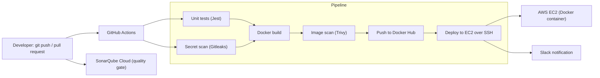
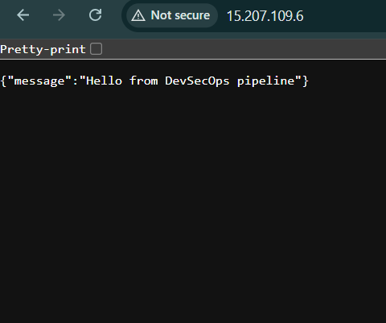
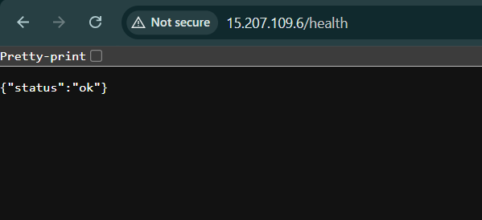

# DevSecOps CI/CD Pipeline


A CI/CD pipeline that tests a small Node.js app, scans it for leaked secrets, code issues and container vulnerabilities, publishes a Docker image, and deploys it to AWS EC2 automatically on every push to `main`. The build **fails automatically** if a secret is committed or the image contains a fixable CRITICAL vulnerability, and SonarQube Cloud reports a quality gate on every push and pull request.

**Author:** Azeem Mirza

---

## Architecture



Pull requests run the tests and security scans only. The push to Docker Hub, the deployment, and the final health check run only on `main`.

---

## Tech stack

| Area | Tool |
|---|---|
| App | Node.js 22, Express, Jest, Supertest |
| CI/CD | GitHub Actions |
| Secret scanning | Gitleaks |
| Static analysis (SAST) | SonarQube Cloud (quality gate) |
| Image scanning | Trivy |
| Containers | Docker, Docker Hub |
| Hosting | AWS EC2 (Ubuntu) |
| Alerts | Slack incoming webhook |

---

## Pipeline stages

1. **Unit tests**: installs dependencies with `npm ci --ignore-scripts` and runs the Jest test suite.
2. **Secret scan**: Gitleaks scans the full git history for committed credentials.
3. **Static analysis**: SonarQube Cloud analyzes every push and pull request and reports a quality gate check on the commit.
4. **Build image**: builds the Docker image, tagged with the commit SHA.
5. **Vulnerability scan**: Trivy scans the image and **fails the build on CRITICAL findings** that have a fix available.
6. **Push**: on `main` only, pushes the image to Docker Hub with the commit SHA tag and `latest`.
7. **Deploy**: connects to the EC2 server over SSH, pulls the new image, replaces the running container, and runs a health check (`curl -f /health`). The job fails if the app does not respond. It runs only on `main` and only when the repository variable `DEPLOY_ENABLED` is `true`.
8. **Notify**: sends the pipeline result with a link to the run to a Slack channel.

Commits that only change Markdown files or the `docs/` folder do not trigger the pipeline.

---

## Screenshots

### Application running on EC2
The app served directly from the EC2 public IP. The root route returns the app message, and the `/health` endpoint is the one the pipeline's health check calls after every deployment.




> **Note:** The EC2 instance has been terminated to avoid AWS charges, so the app is no longer live and the deploy stage is switched off (`DEPLOY_ENABLED` is not set). The screenshots above were taken while the deployment was running.

---

## Security decisions

- **No credentials in code.** Docker Hub, EC2 and Slack credentials are stored as encrypted GitHub Actions secrets and are referenced by name in the workflow.
- **Shift-left scanning.** Secrets, code issues and vulnerabilities are checked before an image is published, not after deployment.
- **Fail closed.** A CRITICAL vulnerability or a leaked secret stops the pipeline, and nothing is pushed or deployed.
- **Pinned actions.** Every GitHub Action is pinned to a full commit SHA, so a moved or hijacked tag cannot change what runs in the pipeline.
- **No install scripts.** Dependencies are installed with `--ignore-scripts` in both the pipeline and the Dockerfile, so package lifecycle scripts never run during the build.
- **Minimal, non-root image.** The Dockerfile copies only the files the app needs, runs as the unprivileged `node` user, and installs production dependencies only (`npm ci --omit=dev`).
- **Deploy only from `main`.** Pull requests never push images or touch the server.
- **SSH trade-off.** Port 22 on the EC2 instance is open to the internet because GitHub-hosted runners use changing IP addresses. Access is key-only (no passwords). In production I would remove this exposure by using AWS Systems Manager Session Manager or a self-hosted runner inside the VPC.

---

## Project structure

```
.
├── .github/workflows/ci-cd.yml   # the pipeline
├── app.js                        # Express app
├── app.test.js                   # unit tests
├── server.js                     # app entry point
├── Dockerfile
├── .dockerignore
├── .gitignore
└── package.json
```

---

## Run it locally

```bash
npm ci
npm test
npm start        # http://localhost:3000  (also /health)
```

Or with Docker:

```bash
docker build -t devsecops-demo .
docker run -p 3000:3000 devsecops-demo
```

---

## Set it up yourself

1. Fork or clone this repository.
2. Launch an Ubuntu EC2 instance, install Docker, and open ports 22 and 80 in its security group.
3. Create a Docker Hub access token and a Slack incoming webhook.
4. Add these repository secrets under **Settings > Secrets and variables > Actions**:

| Secret | Purpose |
|---|---|
| `DOCKERHUB_USERNAME` | Docker Hub username |
| `DOCKERHUB_TOKEN` | Docker Hub access token (read and write) |
| `EC2_HOST` | EC2 public IP address |
| `EC2_USER` | SSH user (`ubuntu`) |
| `EC2_SSH_KEY` | Full contents of the EC2 private key (`.pem`) |
| `SLACK_WEBHOOK_URL` | Slack incoming webhook URL |

5. Add a repository variable (same page, **Variables** tab) named `DEPLOY_ENABLED` with the value `true` to turn on the deploy stage.
6. Push to `main`. The pipeline runs and deploys the app to `http://<EC2_PUBLIC_IP>`.

---

## What I would add next

- **Dependabot** to keep the pinned action SHAs up to date.
- **Ansible playbook** for deployment instead of an inline SSH script.
- **Infrastructure as code:** provision the EC2 instance and security group with Terraform.
- **Image signing and SBOM generation** for supply-chain security.
- **Monitoring** with Prometheus and Grafana.

---

## Lessons learned

- Debugged a failing `trivy-action` step: its tag names had changed upstream, so I updated the version reference.
- Fixed an empty-secret error in the Slack job that showed up as a misleading `curl` exit code.
- Resolved an outbound security-group rule that blocked Docker Hub pulls on the server.
- Cleared the SonarQube Cloud quality gate by pinning actions to commit SHAs, disabling npm install scripts, and copying only the needed files into the image.
- Stopped documentation-only commits from running the pipeline, and added a `DEPLOY_ENABLED` switch so the pipeline stays green when the server is turned off.
